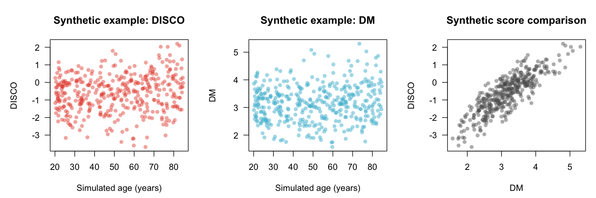

# Reproducible synthetic NHANES-calibrated example

**All rows below are generated, not NHANES participant records.** The generator
uses only the bundled NHANES reference's aggregate biomarker moments. Ages,
sex, age gradients and sample composition are artificial teaching choices.
Do not interpret the plots as cohort results, clinical cutoffs or validation.

```r
library(DISCO4HD) # >= 0.3.1
x <- simulate_nhanes_demo(n = 400, seed = 20261001)
markers <- disco10_reference("NHANES")$markers
disco10_reference("NHANES")$units
scores <- cal_disco10(x, reference = "NHANES")
head(scores[c("synthetic_id", "age", "DISCO", "DM")])
```

`cal_disco10()` uses frozen reference parameters and weights. CRP is supplied in
mg/L and transformed internally with `log1p`; do not transform it twice. DM is
the square-root Mahalanobis distance, not log-DM. Extra columns are retained but
are not predictors in this calculator. Missing values are rejected, not silently
imputed. A synthetic CSV is available at
`system.file("extdata", "synthetic_nhanes_demo.csv", package = "DISCO4HD")`.

The generic research function is different: reference individuals and biomarker
preprocessing are chosen explicitly and age weights are trained in the supplied
analysis sample. It does **not** use the frozen NHANES weights.

```r
x2 <- x
x2$CRP <- log1p(x2$CRP)
generic <- cal_disco(x2, var = markers, ref = x2[x2$age < 30, ],
                     cpp = TRUE, parallel = FALSE)
```

These two workflows need not produce identical numbers. Never choose between
them after seeing which gives the better result. Predefine reference population,
marker units, transformations and weight training before scoring.

## Generate the data and visualization

```r
Sys.setenv(DISCO_EXAMPLE_OUTPUT = "synthetic_demo_output")
source(system.file("examples", "synthetic_nhanes.R", package = "DISCO4HD"))
```



The example exports the input, scores, provenance and PNG. A fixed seed makes it
reproducible, and the generator restores the caller's random-number state.
The historical NHANES4 participant dataset is excluded from this release
candidate pending provenance and redistribution review. This example does not
read participant records.
